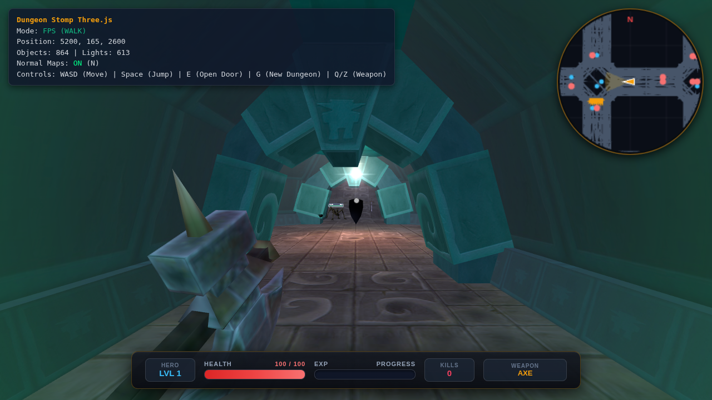

<div align="center">

# ⚔️ Dungeon Stomp Three.js

### A classic first-person dungeon crawler, reborn in your browser.

**Procedural dungeons · Real-time spells · Dozens of monsters · Zero installs · Pure JavaScript + WebGL**




</div>

---

## What is this?

**Dungeon Stomp Three.js** is a browser-based, first-person 3D dungeon crawler built with [Three.js](https://threejs.org/). It is a ground-up JavaScript port of **Dungeon Stomp**, the original Direct3D dungeon crawler by [Mark Longo (moonwho101)](https://github.com/moonwho101), with the classic levels, models, textures and sounds brought to the web.

Swing a flaming sword, hurl fireballs, cast lightning, and stomp through endless **procedurally generated dungeons** crawling with monsters, treasure and traps. Just open it in a browser and play.

> If you grew up on Doom, Quake, Hexen, Eye of the Beholder or Diablo, this one is for you.

## ✨ Features

- 🏰 **Infinite procedural dungeons.** Press `G` any time to generate a brand-new level. Find the glowing exit portal to descend. Every depth is tougher than the last.
- 🗺️ **Classic campaign levels.** Original `.map` levels from the first Dungeon Stomp are loaded straight from `bin/`.
- 🧟 **30 monster families.** Ogres, hydras, dragons, necromancers, demonesses, faeries, mummies, wraiths, goblins, skeletons, wolves, tentacle horrors and more. Each has its own AI, aggro range, pain and death sounds, and attack style.
- 🔮 **Spellcasters that fight back.** Many enemies cast **Magic Missile**, **Fireball** and **Lightning** at you with line-of-sight checks and cooldowns.
- ⚔️ **A full arsenal.** Axe, Flamesword, Bastard Sword, Battle Axe, Ice Sword, Lightning Sword, Morning Star, Spiked Flail, Split Sword and Super Flamesword, plus the spells **Magic Missile**, **Fireball**, **Lightning** and **Healing**.
- 📈 **RPG progression.** Gain XP, level up, collect potions, scrolls, spellbooks and coins, and track your kill count on a modern HUD.
- 💡 **Dynamic lighting and normal mapping.** Hundreds of lights per level, with toggleable normal maps (`N`) for a gritty, tactile look.
- 🧭 **Circular minimap.** See walls, monsters and loot around you at a glance.
- 🚪 **Interactive world.** Open doors and crack open treasure chests.
- 🔊 **Atmospheric audio.** More than 150 original sound effects, plus a rolling music soundtrack (`P` / `M` to toggle).
- 🕹️ **Fly mode and god mode** for exploring, level design and debugging.
- 🪶 **No bundler, no npm, no build.** It's plain ES modules plus an import map. Read it, hack it, mod it.

## 🎮 Controls

| Key | Action |
|-----|--------|
| `W` `A` `S` `D` / Arrow keys | Move |
| Mouse | Look around (click to capture the pointer) |
| Left click | Attack / cast |
| `Space` | Jump (fly up in fly mode) |
| `Shift` | Sprint |
| `Q` / `Z` | Next / previous weapon or spell |
| `E` | Open nearby door |
| `G` | Generate a new dungeon |
| `F` / `V` | Toggle fly mode (`C` / `Ctrl` to descend) |
| `N` | Toggle normal maps |
| `P` / `M` | Toggle music |
| `K` | Cheat: unlock all weapons and spells |
| `I` | Cheat: toggle god mode |
| `Esc` | Pause / release the mouse |

## 🚀 Play it locally

The game loads levels, models and textures with `fetch`, so it has to be served over HTTP. Opening `index.html` directly from disk won't work.

```bash
git clone https://github.com/moonwho101/DungeonStompThreejs.git
cd DungeonStompThreejs

# pick any static server:
python -m http.server 8000
# or
npx serve .
```

Then open **http://localhost:8000** in a modern browser (Chrome, Edge, Firefox or Safari) and click to start.

Three.js is loaded from a CDN (unpkg) through an import map, so you need an internet connection on first load.

### Host it for free
It's a fully static site, so you can publish it with **GitHub Pages**, Netlify, Vercel or Cloudflare Pages. Point them at the repo root, with no build command and no output directory.

## 🧱 Project layout

| Path | Purpose |
|------|---------|
| [`index.html`](index.html) | Entry point, HUD and styles |
| [`app.js`](app.js) | Startup, input handling, pointer lock |
| [`logic.js`](logic.js) | Monsters, AI, combat, items, spells, level loading |
| [`generator.js`](generator.js) | Procedural dungeon generator |
| [`render.js`](render.js) | Three.js renderer, lights, materials, effects |
| [`update.js`](update.js) | Per-frame game loop |
| [`collision.js`](collision.js) | Player and monster collision |
| [`minimap.js`](minimap.js) | Circular minimap |
| [`parsers.js`](parsers.js) | Parsers for the original Dungeon Stomp `.map`, `.mod` and `.cmp` data |
| [`bin/`](bin) | Original level, model-list and collision data |
| [`Models/`](Models) | 3DS and monster models |
| [`Textures/`](Textures) | Textures and normal maps |
| [`Sounds/`](Sounds), [`Midi/`](Midi) | Sound effects and music |
| [`tools/`](tools), [`verification/`](verification) | Asset analysis scripts and automated Playwright checks |

## 🛠️ Built with

- [Three.js](https://threejs.org/) for rendering, `PointerLockControls` and the 3DS loader
- Vanilla JavaScript (ES modules), with no framework and no bundler
- Web Audio / HTML5 audio for sound and music

## 🤝 Contributing

Bug reports, new monsters, level ideas, performance tweaks and pull requests are all welcome. Fork it, break it, make it better.

1. Fork the repo
2. Create a branch: `git checkout -b feature/my-awesome-feature`
3. Commit and push
4. Open a pull request

If you enjoy the project, **⭐ star the repo**. It helps other dungeon crawlers find it.

## 📜 License

Released under the [MIT License](LICENSE). © Mark Longo.

---

<div align="center">

**Dungeon Stomp Three.js**: descend, fight, loot, repeat. 🗡️🔥⚡

</div>
